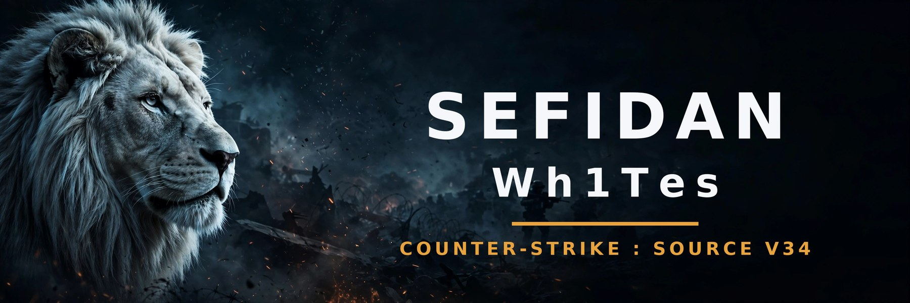

<div align="center">

[🇮🇷 فارسی](README.md) • [🇬🇧 English](README.en.md) • [🇷🇺 Русский](README.ru.md) • [🇹🇷 Türkçe](README.tr.md)

<p align="center"></p>
<p align="center">🌐 <a href="https://armadgarsone2.github.io/counter/">Server website</a></p>


# 🦁 Sefidan | Wh1Tes

### ⚔️ Counter-Strike: Source v34 — a friends' server, no nonsense ⚔️


**Next-gen default skins, a skin shop, a match mode with a live scoreboard, a real ranking system — everything a friends' server needs.**

```
connect 13.53.151.178:27015
```

</div>

---

## 🔥 What's on this server?

| Feature | Details |
|---|---|
| 🎭 **Next-gen default skins** | 10 modern player models (Pro / SWAT / CSGO Master) — everyone looks sharp from the first second |
| 🛒 **Skin shop `!shop`** | 8 legendary classics: Ghost, TF141, Gorka, Mercenary, Juggernaut, Spetsnaz — your pick is saved by name |
| 🏅 **Kill medal overlay** | Every kill adds a numbered card to your medal fan — the number is your kill count this round, shown from round start |
| 🎮 **7 game modes** | One key (J) or the Telegram bot: Classic, **Match**, Headshot-only, Knife+HE, Pistols, AWP, ScoutzKnivez |
| 🏟️ **Real match mode** | Live HUD scoreboard (alive counts + rounds won), anti-ghost force-camera, $800 start money, friendly fire |
| 🎯 **Colored damage display** | HP damage in **red**, armor damage in **blue**, one clean line above the crosshair |
| 🏆 **Rank & leaderboards** | `!rank` / `!top` + per-weapon boards with `!guns` — scoring: kill +3, headshot +1, knife +2, death −1 |
| 🪂 **Parachute** | Jump from high ground and hold USE — soft landing, carbon chute |
| 🔋 **Health & armor chargers** | G7-pack charger stations at both spawns: stand close, hold E, refill |
| 🚀 **RPG view model** | Pick up the AWP and you're holding an RPG-7 |
| 💰 **Max money — Classic mode** | **$16,000** at every round start — no more money whining |
| 🧊 **5-second freezetime** | Not zero chaos, not a nap either — just one deep breath |
| 💣 **Bomb Info** | C4 timer + your distance to the bomb + the damage you'll take — do the math before you blow up |
| 🌫️ **Dense smoke** | A smoke grenade that actually smokes |
| 🔄 **Score reset `!res`** | Wipe your own score whenever you want |
| 🧨 **GunGame (event)** | Enabled from the bot when everyone's in — an event mode, not the default |
| 📜 **Persian server menu `!smenu`** | Rules and server info, properly shaped Persian |
| 🛡️ **Admin panel `!admin`** | Full server management from inside the game |
| 🔊 **Quake + G7 sounds** | Kill/streak effects + knife hits, admin-join and match beeps |

---

## 🎭 Models & the shop

**Defaults (everyone, automatic):** the 10 modern G7-pack skins (vad36 series) — 5 per team, rotated across players.

**Shop (`!shop` in game chat):** the beloved classics:

| Team | Skins |
|---|---|
| CT | 👻 **BZ GIGN** • 🎖️ **TF141** ×3 |
| T | 🪖 **Gorka (Phoenix)** • 🔫 **Mercenary** • 🐗 **Juggernaut** • ❄️ **Spetsnaz** |

Your choice is stored under your player name and re-applied every time you join. Models download automatically over FastDL — just connect.

> ⚠️ Weapons are stock and untouched. Skill talks here, not gun skins.

---

## 🎮 Game modes

An admin opens the mode menu with **J**; the pick applies instantly (round restart + center announcement). Modes can also be switched from the Telegram bot.

| Mode | Summary |
|---|---|
| **Classic** | $16,000 money, 5s freezetime |
| **Match** | $800 start, 6s freezetime, FF on, HUD scoreboard, force-camera, team voice |
| **Headshot Only** | Only headshots count |
| **Knife + HE** | Knife and grenades only |
| **Pistols Only** | Pistols only |
| **AWP Only** | Knife + AWP — buying disabled |
| **ScoutzKnivez** | Scout + knife + low gravity |

---

## 📜 House rules

```
1. No insults or toxicity toward players
2. No cheats, scripts or bug abuse
3. No mic/chat spam
4. No camping behind the enemy spawn
5. Respect the admins
```

---

## 🗂️ Repository layout

```
counter/
├── README.md                  ← the Persian README (main)
├── server/                    ← the whole server, ready to run
│   ├── srcds_run
│   └── cstrike/
│       ├── cfg/               ← configs + game modes (gamemodes)
│       ├── addons/sourcemod/
│       │   ├── plugins/       ← compiled plugins (.smx)
│       │   ├── scripting/     ← plugin sources (.sp) — the wh1tes folder is our custom work
│       │   └── configs/
│       └── maps/  models/  materials/  sound/
├── css-bot/                   ← Telegram admin bot (RCON, modes, backups)
├── tools/                     ← analysis/build scripts + the systemd unit
├── skills/                    ← server-management skills (living documentation)
└── docs/                      ← detailed guides
```

---

## 🚀 Quick start

```bash
# 1. Clone
git clone https://github.com/armadgarsone2/counter.git
cd counter/server

# 2. Make executable
chmod +x srcds_run bin/*

# 3. ⚠️ Change the RCON password (the file ships CHANGE_ME)
nano cstrike/cfg/server.cfg

# 4. Run
./srcds_run -game cstrike +map de_dust2 -maxplayers 32 -port 27015 +tickrate 100

# 5. (Optional) permanent service
sudo cp ../tools/css34.service /etc/systemd/system/
sudo systemctl enable --now css34
```

**FastDL:** files are served by nginx so players pull models at full speed:

```
sv_downloadurl "http://YOUR_SERVER_IP/cstrike/"
```

> ⚠️ FastDL files must be world-readable (644/755) or nginx returns 404 and players fall back to slow direct download.

---

## 🧩 Custom plugins (Wh1Tes)

| Plugin | What it does |
|---|---|
| **Wh1Tes Defaults** | Applies the 10 modern default skins to everyone (rotated) |
| **Wh1Tes Shop** | The `!shop` skin shop — picks saved per player name |
| **Wh1Tes Kill Overlay** | Kill medal + cards — the card number is exactly this round's kills |
| **Wh1Tes Modes** | 7 one-key game modes + match HUD scoreboard & force-camera |
| **Wh1Tes Rank** | Points ranking + per-weapon leaderboards (`!guns`) |
| **Wh1Tes Auth** | Manual admin/VIP binding — this No-Steam build never completes Steam auth |
| **Wh1Tes Damage Info** | Colored damage: HP red, armor blue |
| **Wh1Tes Round Money** | $16,000 in Classic (never touches freezetime) |
| **Wh1Tes Parachute** | Hold USE in the air for a parachute |
| **Wh1Tes G7 Props** | Health/armor chargers + team flags at the spawns |
| **Wh1Tes G7 Extras** | G7 sounds: knife hits, admin join, match beeps & thunder |
| **Wh1Tes RPG** | RPG-7 view model for the AWP |
| **Wh1Tes ResetScore** | `!res` — personal score reset |
| **Wh1Tes Dense Smoke** | Thicker smoke grenades |
| **Bomb Info** | Bomb timer, distance and damage |

Plus: admin panel, server menu, AFK manager, join messages, Quake Sounds and the Telegram admin bot (modes, leaderboards, admin audit log, backups).

---

## ⚙️ Under the hood (for the technical crowd)

- The server tree is **SourceMod 1.7.3**; plugins compile with the tree's own spcomp in transitional style (the `newdecls` pragma breaks against its sdktools includes). A few plugins (Modes, Damage Info) build with the **1.9** toolchain.
- This **No-Steam** build never completes Steam authorization (STEAM_ID_PENDING), so `OnClientPostAdminCheck` never fires — bind admins, VIP and rank loading on `OnClientPutInServer`.
- `exec` at the end of server.cfg runs *after* the file's own lines — exec'd files win. Chase stubborn cvars through every layer.
- The downloads table has a cap: overfill it and clients crash on connect. Keep the list tight — and never change a same-named file: clients keep their cached copy, so ship a new path/name.
- Raw Persian text renders broken in this engine — write English, or reshape to presentation forms first.
- The full war stories live in `skills/`.

---

<div align="center">

**A friendly, non-commercial server — no VIP sales, just friends.** 🤝

Built with ☕ and 🎧 on a small box in Stockholm

</div>

---

### 🔎 Keywords

Counter-Strike: Source v34 dedicated server (srcds) — full server package with SourceMod 1.7.3 plugins, Metamod, custom player models and skin shop, match mode with live HUD scoreboard, rank + per-weapon leaderboards, kill-streak medal overlay, G7 pack (chargers, flags, RPG view model), FastDL, Telegram admin bot and Persian documentation.

<!-- seo: counter-strike-source css v34 counter strike source server dedicated server srcds linux sourcemod metamod plugins skins player models skin shop fastdl gungame wh1tes sefidan -->
